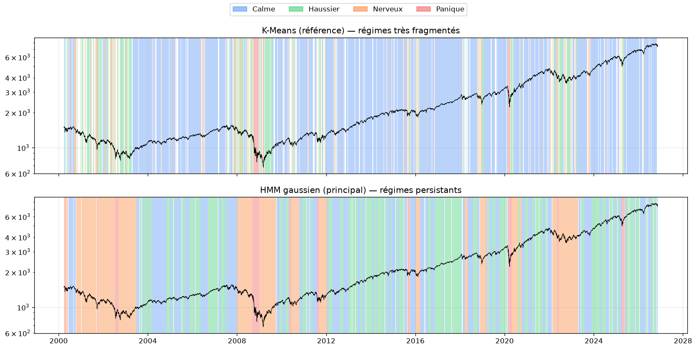

# 🎼 Market Symphony

> **Sonification et art génératif des marchés financiers par apprentissage automatique**
> *Écouter et voir le marché : chaque séance devient une note, chaque régime une ambiance.*

| Élément | Détail |
|---|---|
| Auteure | Sheila Songkana — PGE 2, Aivancity (MSc IA & Data Science) |
| Type de projet | Projet personnel de portfolio (*full-stack* + *Machine Learning* + *finance*) |
| Version | v0.8.0 — novembre 2026 (cahier des charges v1.0) |
| Durée estimée | 6 semaines (≈ 6 à 8 h / semaine) |
| Statut | 🟢 **MVP complet** (S1 → S5) : données, modèles, API, son (Tone.js), art génératif (p5.js), courbe de référence · S6 (déploiement, GIF, bonus) à venir — voir [EVOLUTION.md](EVOLUTION.md) |

> ⚠️ **Projet éducatif — pas de conseil en investissement.**

---

## Sommaire

1. [Présentation](#1-présentation)
2. [Périmètre fonctionnel](#2-périmètre-fonctionnel)
3. [Données](#3-données)
4. [Modélisation Machine Learning](#4-modélisation-machine-learning)
5. [Sonification et rendu visuel](#5-sonification-et-rendu-visuel)
6. [Architecture technique](#6-architecture-technique)
7. [Interface utilisateur](#7-interface-utilisateur)
8. [Exigences non fonctionnelles](#8-exigences-non-fonctionnelles)
9. [Installation et utilisation](#9-installation-et-utilisation)
10. [Configuration](#10-configuration)
11. [Planning](#11-planning)
12. [Livrables et critères de réussite](#12-livrables-et-critères-de-réussite)
13. [Risques et solutions](#13-risques-et-solutions)
14. [Limites](#14-limites)
15. [Lecture d'accompagnement et lexique](#15-lecture-daccompagnement-et-lexique)

---

## 1. Présentation

### 1.1 Contexte
Les marchés financiers sont généralement représentés par des courbes et des tableaux de chiffres, difficiles à appréhender pour un public non initié. **Market Symphony** propose une autre lecture : *écouter* et *voir* le marché. Chaque séance de cotation devient une note de musique et une forme animée ; l'ambiance sonore et visuelle change selon le **régime de marché** détecté par un modèle de Machine Learning (**calme, haussier, nerveux, panique**).

### 1.2 Objectifs
- **Principal** : une application web interactive qui transforme une série de prix en œuvre audiovisuelle pilotée par l'IA.
- **Technique** : démontrer un pipeline complet — collecte de données → *feature engineering* → apprentissage non supervisé → API → frontend.
- **Pédagogique** : rendre perceptibles les grands événements financiers (krachs, bulles) et la notion de volatilité.
- **Portfolio** : une démo en ligne compréhensible en **moins de 30 secondes** par un recruteur.

### 1.3 Public cible
Recruteurs (data science, finance quantitative, medtech), étudiants, curieux de finance et d'art numérique. **Aucune connaissance financière requise.**

---

## 2. Périmètre fonctionnel

### 2.1 Fonctionnalités principales (MVP)

| ID | Fonctionnalité | Description | Implémentation prévue |
|---|---|---|---|
| F1 | Sélection de l'actif | Liste (S&P 500, CAC 40, actions, Bitcoin) ou saisie d'un ticker | `config.yaml → assets`, `GET /assets` |
| F2 | Choix de la période | Sélecteur de dates + préréglages (2008, flash crash 2010, Covid 2020…) | `config.yaml → presets`, `GET /presets` |
| F3 | Détection des régimes | Régime calculé jour par jour par le backend | `app/models/regimes.py` |
| F4 | Lecture audiovisuelle | Lecture/pause, vitesse ×1 à ×8, curseur, son + animation synchronisés | Tone.js + p5.js |
| F5 | Légende des régimes | Couleur, gamme, explication en une phrase | `REGIME_PROFILES` (`constant.py`) |
| F6 | Courbe de référence | Graphique des prix avec régime coloré en arrière-plan | Lightweight Charts |

### 2.2 Fonctionnalités bonus
- 🎮 **« Devine le krach »** : 30 s de musique, 4 propositions, score.
- 💾 **Export** de l'œuvre en PNG ou WebM.
- 🔁 **Matrice de transition** entre régimes (`GET /regimes/transition`).
- 🎻 **Duo** : deux actifs joués simultanément par deux instruments.

### 2.3 Hors périmètre
Aucune **prédiction de prix**, aucun conseil d'investissement, aucun compte utilisateur, aucune donnée en temps réel (journalier historique uniquement).

---

## 3. Données

### 3.1 Sources (gratuites)
| Source | Usage | Statut |
|---|---|---|
| **yfinance** (Yahoo Finance, non officiel) | Actions, indices, crypto — historique journalier | Source principale |
| **CoinGecko API** | Cryptomonnaies | Optionnel |
| **FRED** | Indicateurs macro (ex. VIX) | Optionnel |
| **Alpha Vantage** | Source de secours | Plan B (§13) |

### 3.2 Format et prétraitement
- Données **OHLCV** (*Open, High, Low, Close, Volume*), fréquence journalière.
- Nettoyage : tri, suppression des doublons et jours manquants, prix **ajustés** (dividendes et splits — `auto_adjust: true`).
- **Cache Parquet** dans `data/cache/` (un fichier par ticker, TTL configurable) → la démo ne dépend pas de l'API ; en cas d'échec réseau, le cache existant est utilisé.
- Entraînement : **≥ 20 ans** de S&P 500 (depuis 2000) pour couvrir la bulle Internet, 2008 et 2020.

---

## 4. Modélisation Machine Learning

### 4.1 Variables (features)

| Variable | Colonne | Définition |
|---|---|---|
| Rendement logarithmique | `log_return` | ln(Pₜ / Pₜ₋₁) |
| Volatilité glissante | `volatility` | Écart-type des rendements sur 20 jours × √252 |
| Momentum | `momentum_20`, `momentum_60` | Rendement log cumulé sur 20 et 60 jours |
| Drawdown | `drawdown` | Pₜ / max glissant 252 j − 1 (≤ 0) |
| Volume relatif | `relative_volume` | Volume / moyenne mobile 20 j (1.0 si volume indisponible) |

Code : [backend/app/features/engineering.py](backend/app/features/engineering.py).

### 4.2 Modèles
- **Référence — K-Means** (scikit-learn), 4 clusters sur variables standardisées. Simple, rapide, interprétable.
- **Principal — HMM gaussien** (hmmlearn), 4 états cachés. Prend en compte la **persistance temporelle** des régimes et évite les changements parasites d'un jour à l'autre.
- **Nommage automatique** des états ([`label_states`](backend/app/models/regimes.py)) :
  1. volatilité moyenne la plus forte → **panique** ;
  2. parmi le reste, meilleur ratio rendement / volatilité → **haussier** ;
  3. des deux restants, volatilité la plus forte → **nerveux** ;
  4. le dernier → **calme**.

  Le ratio rendement/volatilité évite d'étiqueter « haussier » un état à rendement à peine positif mais très agité (cas du marché baissier de 2022 avec une première règle naïve, voir EVOLUTION v0.2.0).

Les modèles sont entraînés **hors ligne** (`scripts/train.py`) puis sauvegardés avec *joblib* dans `models/` ; l'API ne fait que de l'inférence.

### 4.3 Évaluation
En l'absence de vérité terrain, l'évaluation est **qualitative et statistique** :
- **Cohérence historique** : sept.–nov. 2008 et mars 2020 doivent être classés *panique* (`models.evaluation.panic_checks`).
- **Indicateurs** : silhouette (K-Means), log-vraisemblance et **BIC** pour choisir le nombre d'états (HMM, 2 à 6 états testés).
- **Stabilité** : durée moyenne d'un régime ≥ 5 jours (`mean_regime_duration`).

### 4.4 Résultats (S&P 500, 2000 → 2026, 6 697 séances)



| Régime (HMM) | Jours | Rendement annualisé | Volatilité moyenne |
|---|---|---|---|
| 🟢 Haussier | 2 290 | +25 % | 9 % |
| 🔵 Calme | 2 346 | ≈ 0 % | 14 % |
| 🟠 Nerveux | 1 742 | +2 % | 22 % |
| 🔴 Panique | 319 | −59 % | 47 % |

| Critère | K-Means | **HMM** |
|---|---|---|
| Panique sept.–nov. 2008 | 80 % | **100 %** ✅ |
| Panique mars 2020 | 73 % | **100 %** ✅ |
| 2017 (marché haussier) | 100 % « calme » | **93 % haussier** |
| 2022 (marché baissier) | 46 % « haussier » ❌ | **76 % nerveux** |
| Durée moyenne d'un régime | 5,7 jours | **31,4 jours** |
| Silhouette | 0,32 | — |

La matrice de transition du HMM dessine une échelle *haussier ↔ calme ↔ nerveux ↔ panique* : un marché haussier ne bascule jamais directement en panique, et la panique ne se termine qu'en passant par une phase nerveuse. Le BIC décroît encore au-delà de 4 états (grand échantillon) ; **4 états** sont retenus pour l'interprétabilité et les 4 ambiances musicales. Détails : [notebooks/01_exploration.ipynb](notebooks/01_exploration.ipynb).

---

## 5. Sonification et rendu visuel

Le cœur artistique repose sur une **table de correspondance** calculée côté serveur ([backend/app/sonification/mapping.py](backend/app/sonification/mapping.py)) : le frontend n'a qu'à « jouer » la partition reçue.

| Donnée | Son (Tone.js) | Visuel (p5.js) |
|---|---|---|
| Rendement du jour | **Hauteur** de la note (hausse = aigu), quantifiée sur la gamme du régime | Position verticale |
| Volatilité | **Tempo** (70 → 160 BPM) et **réverbération** | Taille et agitation des particules |
| Volume relatif | **Intensité** (vélocité) | Opacité / luminosité |
| Régime « calme » 🔵 | Gamme majeure, piano doux, legato | Bleus, formes rondes et lentes |
| Régime « haussier » 🟢 | Gamme pentatonique, rythme vif | Verts et dorés, spirales ascendantes |
| Régime « nerveux » 🟠 | Gamme mineure, staccato | Orangés, formes anguleuses |
| Régime « panique » 🔴 | Dissonances (secondes mineures, triton), percussions graves | Rouges, éclats et dispersion |

Pour éviter un son désagréable, les notes sont **quantifiées sur une gamme** et limitées à **2 octaves** autour du Do central (MIDI 60).

---

### 5.1 Comment le son est construit

Le navigateur joue la partition comme un **petit ensemble** : une séance = un temps, quatre temps = une mesure ([frontend/src/audio/](frontend/src/audio/)).

| Pupitre | Rôle |
|---|---|
| Mélodie | Note du jour envoyée par l'API, jouée par l'instrument du régime ; **aux temps forts, elle se cale sur l'accord en cours** (plus haut = hausse, toujours) |
| Harmonie ([harmony.ts](frontend/src/audio/harmony.ts)) | Une **grille d'accords par régime**, un accord par mesure : calme I–vi–IV–V (Cmaj7 · Am7 · Fmaj7 · G6) ; haussier I–V–vi–IV (Cadd9 · G · Am7 · Fmaj7) ; nerveux i–VI–iv–V7 (Cm7 · A♭maj7 · Fm7 · G7, tension de dominante) ; panique : accords diminués qui glissent par demi-tons |
| Basse | Fondamentale de l'accord au 1ᵉʳ temps (et au 3ᵉ, à l'octave ou à la quinte, dès que le marché s'anime) |
| Batterie | Calme : presque rien · haussier : grosse caisse 1 et 3, charleston à chaque temps et contretemps · nerveux : charleston décalé (« la marche boite ») · panique : grosse caisse à chaque temps, comme un cœur qui s'emballe |
| Instruments | Calme : piano doux, une tierce répond en fin de mesure · **haussier : lead FM + arpège ascendant brillant sur les notes de l'accord** · nerveux : staccato filtré, note répétée si agitation · panique : cluster en seconde mineure + grondement |
| Transitions | Chaque changement de régime ouvre une nouvelle section (retour au 1ᵉʳ temps), annoncée par un souffle de bruit filtré |
| Durée d'une séance | `250 ms × 100 / tempo` ÷ vitesse : un marché agité **accélère**, un marché calme s'étire |
| Mixage | Compresseur puis limiteur : volume général élevé sans saturation ; vélocité plancher pour que les séances à faible volume restent audibles |
| Accessibilité | Aucun son avant un clic sur ▶ ; bouton muet, volume, barre d'espace = lecture/pause |

### 5.2 Comment l'image est construite (S5)

| Élément | Implémentation ([frontend/src/visual/sketch.ts](frontend/src/visual/sketch.ts)) |
|---|---|
| Composition | la toile **se peint au fil de la période** : axe horizontal = temps, hauteur = rendement du jour ; en fin de lecture, l'image résume toute la période |
| Particules | 2 à 12 par séance selon la volatilité ; taille et vitesse suivent l'agitation, la luminosité suit le volume |
| Calme 🔵 | cercles qui flottent lentement (bruit de Perlin) |
| Haussier 🟢 | spirales ascendantes, reflet doré |
| Nerveux 🟠 | triangles, trajectoires brisées |
| Panique 🔴 | éclats projetés dans tous les sens puis attirés vers le bas |
| Tête de lecture | halo pulsant au jour courant, pulsation plus rapide quand la volatilité monte |
| Courbe F6 | [PriceChart.tsx](frontend/src/components/PriceChart.tsx) : prix, partie jouée en blanc, bandes de régime en fond, **clic = se placer à cette date** |
| Atmosphère ([regimeFx.ts](frontend/src/visual/regimeFx.ts)) | autour de la tête de lecture, l'ambiance du régime : lune et ondes (calme), soleil et notes (haussier), éclairs (nerveux), onde de choc et pluie de caractères (panique). Ce vocabulaire est partagé par la toile, la courbe (bandes texturées animées), la scène d'accueil, le marché ASCII et les tableaux des humeurs |
| Accessibilité | `prefers-reduced-motion` : mouvements ralentis |

## 6. Architecture technique

### 6.1 Pile technologique
| Couche | Technologies |
|---|---|
| Backend | Python 3.11, FastAPI, pandas, scikit-learn, hmmlearn, yfinance, joblib |
| Frontend | React + Vite + TypeScript, Tone.js, p5.js, Lightweight Charts |
| Déploiement | Frontend → Vercel ; Backend → Render ou Hugging Face Spaces |
| Outils | Git/GitHub, pytest, Jupyter |

### 6.2 Schéma d'architecture

```
                 ┌────────────────────── OFFLINE ──────────────────────┐
  yfinance  ──►  │ fetcher.py ─► engineering.py ─► train.py ─► models/  │
  (Parquet       │  (cache)        (features)     (KMeans/HMM)  *.joblib│
   cache)        └──────────────────────────────────────┬──────────────┘
                                                        │ chargement
                 ┌────────────── API FastAPI (inférence) ▼──────────────┐
  Navigateur ──► │ /assets  /presets  /symphony  /regimes/transition   │
       ▲         │ features ─► HMM.predict ─► mapping.py (partition)   │
       │         └──────────────────────────────┬───────────────────────┘
       │                       JSON (jour par jour)
  ┌────┴───────────────── Frontend React ───────▼────────────────────────┐
  │ Tone.js (son) · p5.js (canevas génératif) · Lightweight Charts      │
  │ Repli : /public/presets/*.json pré-calculés si le backend dort       │
  └─────────────────────────────────────────────────────────────────────┘
```

### 6.3 Points d'accès de l'API

| Méthode | Route | Rôle |
|---|---|---|
| GET | `/health` | Vérification de disponibilité |
| GET | `/assets` | Liste des actifs disponibles |
| GET | `/presets` | Périodes historiques préréglées |
| GET | `/symphony?ticker=&start=&end=` | Pour chaque jour : prix, features, régime, paramètres audio et visuels |
| GET | `/regimes/transition` | Matrice de transition du HMM (bonus) |

Codes d'erreur : **422** pour une entrée invalide (date mal formée, ticker hors format, dates inversées, période > 10 ans), **404** pour des données indisponibles, **503** si le modèle n'est pas entraîné.

Exemple de réponse `/symphony` (un jour) :
```json
{
  "date": "2008-10-15",
  "close": 907.84,
  "features": { "log_return": -0.0947, "volatility": 0.78, "...": 0 },
  "regime": "panic",
  "audio":  { "midi": 48, "velocity": 0.93, "tempo_bpm": 157.2, "reverb_wet": 0.68,
              "instrument": "low_percussion", "articulation": "accented" },
  "visual": { "y": -1.0, "size": 39.1, "agitation": 0.97, "opacity": 241,
              "color": "#EF4444", "shape": "shard" }
}
```

### 6.4 Structure du dépôt

```
Market_symphony/
├── README.md                  ← ce document
├── EVOLUTION.md               ← journal des modifications
├── config.yaml                ← paramètres réglables (données, features, modèles, son…)
├── test.py                    ← diagnostic complet backend + frontend
├── backend/
│   ├── requirements.txt
│   ├── pyproject.toml         ← configuration pytest
│   ├── app/
│   │   ├── main.py            ← application FastAPI
│   │   ├── core/
│   │   │   ├── constant.py    ← constantes invariantes (chemins, colonnes, régimes)
│   │   │   ├── config.py      ← chargement + validation Pydantic de config.yaml
│   │   │   └── network.py     ← bundle CA (compatibilité antivirus HTTPS)
│   │   ├── data/fetcher.py    ← collecte + cache Parquet
│   │   ├── features/engineering.py
│   │   ├── models/regimes.py  ← K-Means, HMM, nommage, persistance
│   │   ├── sonification/mapping.py
│   │   ├── services/symphony.py ← logique métier (prix → régimes → partition)
│   │   └── api/{routes,schemas}.py ← couche HTTP : validation des entrées, codes d'erreur
│   ├── scripts/
│   │   ├── train.py           ← entraînement hors ligne
│   │   └── export_presets.py  ← JSON pré-calculés pour le frontend
│   └── tests/                 ← pytest (features, régimes, mapping, API)
├── frontend/
│   ├── package.json · vite.config.ts · tsconfig.json · index.html
│   ├── public/presets/        ← préréglages pré-calculés (repli hors ligne)
│   └── src/
│       ├── pages/             ← Home, Studio, Context, About (Méthode), Game
│       ├── content/           ← textes éditoriaux (épisodes, acteurs, méthode, lexique)
│       ├── components/        ← SelectionPanel, PlaybackBar, RegimeLegend, Stage, PriceChart, SessionReceipt
│       │   └── ui/            ← Receipt (ticket), AsciiMarket, AsciiGlyph, GlitchText
│       ├── hooks/             ← usePlayer (lecture), useSymphony (chargement)
│       ├── audio/             ← moteur Tone.js : engine, instruments, timing
│       ├── visual/            ← sketch p5.js (toile générative)
│       ├── lib/api.ts         ← client HTTP + repli JSON
│       ├── types/symphony.ts  ← types miroir des schémas API
│       └── config/constants.ts
├── notebooks/01_exploration.ipynb
├── data/{raw,cache,processed}/   ← non versionnés
├── models/                       ← modèles .joblib (non versionnés)
└── docs/                         ← graphique des régimes, schémas, GIF de démo
```

---

## 7. Interface utilisateur

| Page | Contenu |
|---|---|
| **Accueil** `/` | **Scène animée « crépuscule sur les marchés »** (ciel violet-rose-orange, carte du monde en points, chandeliers qui suivent les 4 régimes, casque d'où s'envolent des notes, skyline néon en ASCII avec Grande Arche et temple boursier, reflet dans l'eau, panneaux terminal `[ MARCHÉS ]` et `[ ÉCOUTE ]`), mot d'accroche qui change avec effet *datamosh*, ruban défilant, marché ASCII animé, bouton **« Écouter le krach de 2008 »**, principe en trois temps, les quatre humeurs (glyphes ASCII animés), programme des concerts sous forme de **ticket de caisse** |
| **Studio** `/studio` | Préréglages et période libre à gauche ; **toile générative** p5.js au centre ; courbe, légende et barre de lecture ; **ticket de séance** à droite (part de chaque régime, pire et meilleure séance, pire repli, performance, tampon « KRACH ») |
| **Contexte** `/contexte` | Ce qu'est un marché et le S&P 500 ; **les acteurs** (bourses, fournisseurs d'indices, banques centrales, régulateurs, gérants, banques, agences de notation, entreprises, particuliers) ; **huit épisodes** détaillés : contexte, causes, protagonistes, chiffres clés (calculés sur les données du projet), ce que l'on entend |
| **Méthode** `/methode` | Quoi / comment / pourquoi ; pipeline en cinq mouvements ; les mesures, les modèles (K-Means contre HMM), la matrice de transition, pourquoi le projet ne prédit pas ; boîte à outils, limites, **lexique**. Les explications s'appuient sur des figures de style (métaphores, comparaisons) pour être accessibles à tous |
| **Devine le krach** `/jeu` | 5 manches : un extrait de 100 séances sans date ni prix, 4 propositions, bonus de rapidité, fiche de contexte après chaque réponse, **reçu de partie** et titre final |

**Charte graphique** : tons clairs « papier de caisse » (fond crème tramé, encre chaude) relevés d'accents « crépuscule » (violet → rose → orange, menthe et corail des chandeliers), trois voix typographiques (*Instrument Serif* pour les titres, *DM Sans* pour le texte, *JetBrains Mono* pour les données et l'ASCII), **couleur réservée aux régimes**. Motifs : tickets de caisse dentelés, art ASCII animé, *datamosh* (titres, transitions de page, glissements de pixels sur la toile à chaque changement de régime). `prefers-reduced-motion` est respecté partout.

---

## 8. Exigences non fonctionnelles

| Exigence | Cible |
|---|---|
| Performance | Réponse API < **2 s** pour 5 ans de données ; animation à **60 fps** |
| Compatibilité | Chrome, Firefox, Safari récents ; ordinateur + consultation mobile |
| Qualité du code | Code commenté et typé ; tests unitaires (features, API) |
| Accessibilité | Bouton de coupure du son ; **le son ne démarre jamais automatiquement** |
| Reproductibilité | `requirements.txt`, graine fixée (`random_seed: 42`), instructions ci-dessous |

---

## 9. Installation et utilisation

### Prérequis
- **Python 3.11** (recommandé : `hmmlearn` ne fournit pas toujours de wheels pour les versions les plus récentes)
- **Node.js ≥ 18**

### Backend
```bash
cd backend
# Option A (recommandée) — uv installe Python 3.11 si besoin (voir .python-version)
uv venv --python 3.11 .venv
uv pip install --python .venv -r requirements.txt
# Option B — Python 3.11 déjà installé
py -3.11 -m venv .venv && .venv\Scripts\pip install -r requirements.txt

# Windows : .venv\Scripts\activate    |    macOS/Linux : source .venv/bin/activate

python -m scripts.train --bic          # télécharge le S&P 500, entraîne K-Means + HMM
python -m scripts.export_presets       # (optionnel) JSON pré-calculés pour le frontend
python -m app.main                     # API sur http://127.0.0.1:8010 (docs : /docs)
pytest                                 # tests unitaires
```

> **Antivirus et HTTPS (Windows)** : certains antivirus (ex. Avast *Web Shield*) interceptent le HTTPS avec leur propre certificat, ce qui provoque l'erreur `unable to get local issuer certificate` dans yfinance ou `uv`. Le projet ajoute automatiquement les certificats du magasin Windows au bundle CA ([network.py](backend/app/core/network.py), `network.use_system_certificates` dans `config.yaml`) ; la vérification TLS n'est jamais désactivée. Pour `uv`, ajouter `--native-tls`.

### Vérifier que tout fonctionne
```bash
python test.py              # diagnostic complet backend + frontend (≈ 15 s)
python test.py --quick      # sans pytest, TypeScript ni build (≈ 5 s)
python test.py --network    # ajoute un téléchargement réel via yfinance
python test.py --only backend   # ou --only frontend ; -v pour les traces complètes
```
Le script se relance tout seul avec `backend/.venv` et contrôle : environnement et dépendances, `config.yaml` / `constant.py`, cache de données (≥ 20 ans), modèles, **critères de réussite** (panique 2008 / 2020, stabilité), tests pytest, routes de l'API et temps de réponse (< 2 s), Node et paquets npm, **synchronisation backend ↔ frontend** (couleurs, vitesses, types TypeScript ↔ schémas Pydantic), préréglages JSON, `tsc` et build Vite. Code de sortie 1 en cas d'échec.

### Frontend
```bash
cd frontend
cp .env.example .env.local             # VITE_API_URL=http://127.0.0.1:8010
npm install
npm run dev                            # http://localhost:5180
```

---

## 10. Configuration

Deux niveaux de paramétrage, à garder distincts :

| Fichier | Contenu | Quand le modifier |
|---|---|---|
| [`config.yaml`](config.yaml) | Paramètres **réglables** : actifs, préréglages, fenêtres des features, nombre d'états, hyperparamètres, plages de tempo/octaves, CORS… | Expérimentations, ajustements |
| [`backend/app/core/constant.py`](backend/app/core/constant.py) | Constantes **invariantes** : chemins, noms de colonnes, énumération `Regime`, profils audiovisuels des régimes | Rarement — impacte API et frontend |
| [`frontend/src/config/constants.ts`](frontend/src/config/constants.ts) | Miroir côté frontend (couleurs, vitesses, URL API) | À synchroniser avec le backend |

`config.yaml` est **validé au démarrage** par des modèles Pydantic ([config.py](backend/app/core/config.py)) : clé inconnue (faute de frappe), type erroné, intervalle inversé, `start ≥ end`, feature inexistante ou vitesse par défaut absente de la liste. Dans tous ces cas, le démarrage échoue avec un message qui indique le champ en cause. Accès typé : `get_settings().features.volatility_window`.

Le chemin de la configuration peut être surchargé via la variable d'environnement `MARKET_SYMPHONY_CONFIG`.

---

## 11. Planning

| Semaine | Tâches | Livrable | Lecture (Malkiel) |
|---|---|---|---|
| S1 | Collecte, exploration (notebook), features | Notebook + données en cache | Partie 1 |
| S2 | K-Means & HMM, choix du nombre d'états, nommage | Modèle sauvegardé + graphique des régimes | Partie 1 |
| S3 | API FastAPI, mapping audiovisuel, tests | API fonctionnelle en local | Partie 2 |
| S4 | Frontend React : sélection, lecture, son (Tone.js) | Prototype sonore | Partie 2 |
| S5 | Art génératif (p5.js), courbe, légende, préréglages | **MVP complet** | Partie 3 |
| S6 | Déploiement, README, GIF de démo, bonus | **Application en ligne** | Partie 4 |

L'avancement réel est tracé dans [EVOLUTION.md](EVOLUTION.md).

---

## 12. Livrables et critères de réussite

**Livrables**
- Application déployée, accessible par **lien public**.
- Dépôt GitHub avec README : GIF de démonstration, schéma d'architecture, méthode, section *Limites*.
- Notebook d'exploration expliquant le choix du modèle.

**Le projet est réussi si :**
- ✅ les crises de **2008** et **2020** sont identifiées en régime *panique* ;
- ✅ la démo fonctionne **sans erreur en un clic** ;
- ✅ un non-spécialiste **« entend »** la différence entre un marché calme et un krach.

---

## 13. Risques et solutions

| Risque | Solution prévue |
|---|---|
| Indisponibilité de yfinance | Cache Parquet + source de secours (Alpha Vantage) |
| Régimes peu interprétables | Comparer K-Means / HMM ; ajuster le nombre d'états via le BIC |
| Son désagréable ou monotone | Notes quantifiées sur une gamme ; plage limitée à 2 octaves |
| Mise en veille du backend gratuit | Préréglages pré-calculés en JSON côté frontend (`public/presets/`) |
| Incompatibilité `hmmlearn` / Python récent | Environnement Python 3.11 dédié (`.python-version`) |
| Antivirus interceptant le HTTPS | Bundle CA certifi + magasin Windows (`network.py`) |

---

## 14. Limites

- Les régimes sont **descriptifs**, pas prédictifs : ils résument le passé, ils ne disent rien du lendemain.
- L'étiquetage des états repose sur des règles simples (rendement moyen, volatilité) et suppose 4 états.
- Le modèle est entraîné sur le S&P 500 : appliqué à d'autres actifs (Bitcoin notamment, bien plus volatil), il peut surreprésenter les régimes *nerveux* / *panique*.
- Les features utilisent des fenêtres glissantes : les ~60 premiers jours d'une série servent d'échauffement.
- Avant ~1960, Yahoo ne fournit pas de volume pour le S&P 500 : le volume relatif est neutre (1.0) et l'intensité des notes ne varie pas sur ces périodes.
- yfinance est une bibliothèque non officielle, sujette à des changements de format.

---

## 15. Lecture d'accompagnement et lexique

### Œuvre recommandée
**Burton G. Malkiel — *A Random Walk Down Wall Street*** (1ʳᵉ éd. 1973, privilégier la plus récente). Écrit pour un public non spécialiste, il raconte l'histoire des bulles et des krachs, explique le vocabulaire fondamental et pose la question centrale : *les marchés sont-ils prévisibles ?* — exactement ce qui justifie que Market Symphony **décrive** les régimes plutôt que de **prédire** les prix.

### Grands événements à sonifier
| Date | Événement | En bref | Préréglage |
|---|---|---|---|
| 1637 | Tulipomanie | Première bulle spéculative connue | — (pas de données) |
| 1929 | Krach de Wall Street | Effondrement suivi de la Grande Dépression | `crash_1929` |
| 1987 | Lundi noir | Chute de plus de 20 % du Dow Jones en une séance | `black_monday_1987` |
| 2000 | Bulle Internet | Éclatement de la survalorisation des *dot-com* | `dotcom_2000` |
| 2008 | Crise des subprimes | Faillite de Lehman Brothers | `subprime_2008` |
| 2010 | Flash crash | Chute éclair liée au trading algorithmique | `flash_2010` |
| 2020 | Krach du Covid-19 | Chute très rapide puis rebond spectaculaire | `covid_2020` |

### Lexique
| Terme | Définition |
|---|---|
| Action / indice | Part du capital d'une entreprise / panier d'actions représentatif (CAC 40, S&P 500) |
| Ticker | Code boursier (ex. `AAPL` pour Apple, `^GSPC` pour le S&P 500) |
| Rendement | Gain ou perte relative sur une période |
| Volatilité | Amplitude des variations de prix ; principale mesure du risque |
| Drawdown | Perte maximale depuis un plus haut |
| Bull / bear market | Marché haussier / baissier (baisse > 20 %) |
| Bulle / krach | Prix déconnecté de la valeur réelle / chute brutale et généralisée |
| Liquidité | Facilité à acheter ou vendre sans modifier le prix |
| Régime de marché | Phase durable aux caractéristiques stables (tendance, volatilité) |
| Marche aléatoire | Hypothèse selon laquelle les variations futures sont imprévisibles |
| Efficience des marchés | Les prix intègrent déjà toute l'information disponible |
| HMM | *Hidden Markov Model* : modèle où un état caché (le régime) génère les observations et évolue selon une matrice de transition |

---

*Market Symphony — projet éducatif, pas de conseil en investissement.*
